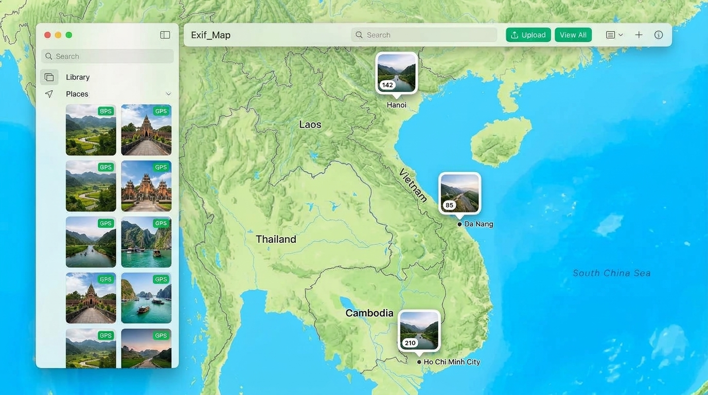
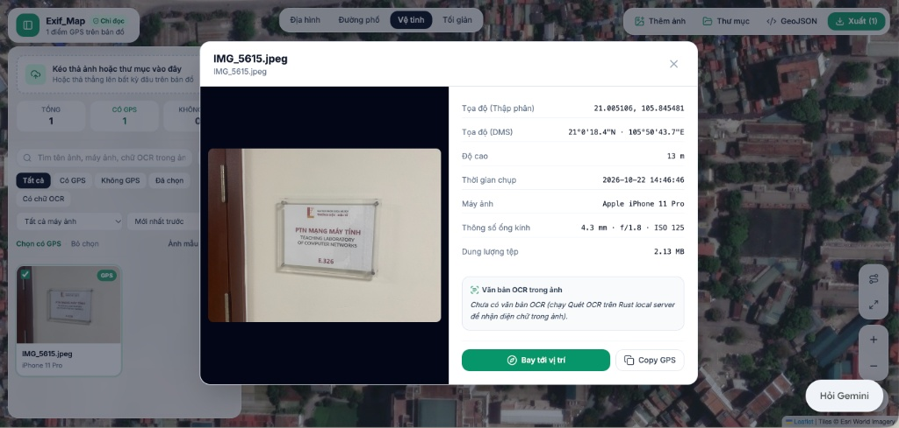

# Exif_Map

Ứng dụng **Rust local server ([`axum`](https://docs.rs/axum/latest/axum/)) + Web UI bản đồ tràn viền** giúp quản lý thư viện ảnh EXIF theo chế độ **chỉ đọc**, nhận diện chữ trong ảnh bằng **OCR gốc của hệ điều hành (có cache)**, tự động gom cụm ảnh theo tọa độ GPS kiểu Apple Photos và xuất dữ liệu **GeoJSON (RFC 7946)**.





## Tính năng chính

* **Bản đồ tràn viền kiểu Apple Photos:** Hiển thị ảnh dưới dạng ghim vuông bo góc viền trắng có mũi nhọn; các ảnh gần nhau tự động gom cụm kèm bộ đếm số lượng ảnh và tách cụm mượt mà khi phóng to.
* **OCR gốc hệ điều hành + Cache cục bộ:** Nhận diện chữ trong ảnh trực tiếp trên máy (macOS dùng **Apple Vision `vi-VN` + `en-US`**, Windows dùng **`Windows.Media.Ocr`**, Linux dùng **Tesseract**) và lưu kết quả vào `.exif_map_ocr_cache.json` theo kích thước + thời gian sửa đổi file để các lần quét sau gần như tức thì.
* **Tìm kiếm nội dung chữ trong ảnh (hỗ trợ không dấu tiếng Việt):** Nhập `"nội dung A"` hoặc `"noi dung a"` vào ô tìm kiếm để lọc ngay những ảnh chứa chữ tương ứng và cập nhật đồng bộ các ghim trên bản đồ.
* **Quản lý file ảnh chỉ đọc (Read-only):** Ngăn kéo kính mờ thu gọn được ở cạnh trái hỗ trợ xem dạng lưới/danh sách, lọc theo trạng thái GPS (`Tất cả`, `Có GPS`, `Không GPS`, `Đã chọn`, `Có chữ OCR`), lọc theo mẫu máy ảnh và sắp xếp theo thời gian chụp. Không bao giờ sửa đổi, di chuyển hay xóa tệp ảnh gốc.
* **Kéo thả trực tiếp:** Kéo thả từng ảnh hoặc cả thư mục (bao gồm thư mục con) vào ngăn kéo hoặc thả thẳng lên bất kỳ vị trí nào trên bản đồ.
* **Đa định dạng ảnh:** Hỗ trợ JPEG, TIFF, HEIC/HEIF, PNG, WebP, AVIF thông qua [`kamadak-exif`](https://docs.rs/kamadak-exif).
* **Xuất chuẩn GeoJSON (RFC 7946):** Xem trước mã JSON, sao chép nhanh hoặc tải tệp `exif_map.geojson` theo đúng thứ tự tọa độ `[kinh_độ, vĩ_độ]` (kèm `độ_cao` và `ocr_text` nếu có).

## Yêu cầu hệ thống

* **Rust & Cargo:** Phiên bản `1.75` trở lên (yêu cầu của `axum 0.8`).
* **OCR hệ điều hành:**
  * **macOS:** Có sẵn Apple Vision + `swift` (cài Xcode Command Line Tools nếu chưa có: `xcode-select --install`).
  * **Windows:** Windows 10/11 có sẵn `Windows.Media.Ocr` qua PowerShell.
  * **Linux:** Cài `tesseract-ocr` và gói ngôn ngữ tiếng Việt (`sudo apt install tesseract-ocr tesseract-ocr-vie`).
* **Trình duyệt hiện đại:** Chrome, Edge, Safari hoặc Firefox.

## Cấu trúc dự án

```text
Exif_Map/
├── Cargo.toml        # Khai báo package Exif_Map và các crate phụ thuộc
├── README.md         # Tài liệu hướng dẫn chi tiết
├── assets/
│   ├── demo.jpg              # Ảnh minh họa giao diện bản đồ tổng quan Exif_Map
│   └── demo_exif_detail.jpg  # Ảnh demo thực tế xem chi tiết EXIF trên nền vệ tinh
├── src/
│   ├── main.rs       # Máy chủ cục bộ Axum (chỉ đọc), API OCR nền + chế độ CLI
│   └── ocr.rs        # Module OCR gốc hệ điều hành (macOS/Windows/Linux) + JSON cache
└── ex/
    └── I love Ngan Anh
```

## Cài đặt & Cách chạy

### 1. Chạy chế độ Web UI (mặc định)

Mở terminal trong thư mục `Exif_Map/` và chạy:

```bash
cargo run
```

Mở trình duyệt tại `http://127.0.0.1:3030` (hoặc đổi cổng bằng `cargo run -- --serve 8080`). Trong thanh quản lý bên trái:
1. Nhập đường dẫn thư mục ảnh trên máy (ví dụ `/Users/ban/Pictures/Travel`) rồi bấm **Quét**.
2. Bấm **OCR** để chạy nhận diện chữ nền; kết quả tự động lưu vào `.exif_map_ocr_cache.json`.
3. Gõ từ khóa cần tìm (có dấu hoặc không dấu) vào ô tìm kiếm để lọc ảnh và ghim bản đồ.

### 2. Chạy chế độ dòng lệnh (CLI)

Quét toàn bộ thư mục ảnh và xuất GeoJSON:

```bash
cargo run -- ./photos map.geojson
```

Quét thư mục ảnh và **chỉ xuất những ảnh có chứa chữ `"nội dung A"`** (tự động dùng OCR cache):

```bash
cargo run -- ./photos filtered.geojson --ocr "nội dung A"
```

### 3. Biên dịch bản tối ưu (Release) & Chạy test

```bash
cargo build --release
cargo test
```

## API của Rust Local Server

| Method | Endpoint | Mô tả |
| :--- | :--- | :--- |
| `GET` | `/` | Trả về giao diện Web UI (`web/index.html`). |
| `POST` | `/api/scan` | Nhận JSON `{ "folder": "/duong/dan" }`, quét EXIF chỉ đọc và nạp sẵn kết quả OCR từ cache nếu có. |
| `POST` | `/api/ocr/start` | Khởi chạy tác vụ nền quét OCR hệ điều hành cho toàn bộ ảnh chưa có trong cache và tự lưu `.exif_map_ocr_cache.json`. |
| `GET` | `/api/ocr/status` | Trả về tiến độ quét OCR (`done`, `total`, `fromCache`, `errors`) kèm danh sách ảnh đã cập nhật `ocrText`. |
| `GET` | `/api/search?q=...` | Tìm kiếm ảnh theo tên, máy ảnh hoặc chữ OCR (hỗ trợ tiếng Việt không dấu). |
| `GET` | `/api/photos` | Trả về danh sách ảnh trong phiên hiện tại. |
| `GET` | `/api/photo/{id}` | Trả về nội dung tệp ảnh theo `id` đã lập chỉ mục (chặn truy cập đường dẫn tùy ý). |
| `GET` | `/api/geojson` | Xuất toàn bộ ảnh có GPS trong phiên dưới dạng GeoJSON `FeatureCollection`. |

## Ví dụ đầu ra GeoJSON

```json
{
  "type": "FeatureCollection",
  "features": [
    {
      "type": "Feature",
      "geometry": {
        "type": "Point",
        "coordinates": [105.8525, 21.02889, 15.9]
      },
      "properties": {
        "filename": "hoan_kiem_hoang_hon.jpg",
        "path": "sample_album/hanoi/hoan_kiem_hoang_hon.jpg",
        "datetime": "2026-10-15 17:42:10",
        "camera_make": "NIKON CORPORATION",
        "camera_model": "Nikon Z6 II",
        "altitude": 15.9,
        "ocr_text": "Hồ Hoàn Kiếm — Tháp Rùa Hà Nội"
      }
    }
  ]
}
```

## Lưu ý

* **An toàn dữ liệu:** Ứng dụng không bao giờ sửa hay xóa ảnh gốc; chỉ tạo một tệp cache nhỏ `.exif_map_ocr_cache.json` trong thư mục chạy chương trình để tăng tốc các lần tìm kiếm sau.
* **Ảnh bị mất EXIF:** Các ảnh gửi qua Zalo, Messenger, Facebook thường bị xóa EXIF nên sẽ hiển thị ở mục **Không GPS**, nhưng vẫn được quét OCR và tìm kiếm chữ bình thường.
* **Thứ tự tọa độ:** Chuẩn GeoJSON (RFC 7946) luôn đặt `[longitude, latitude]` (kinh độ trước, vĩ độ sau).
